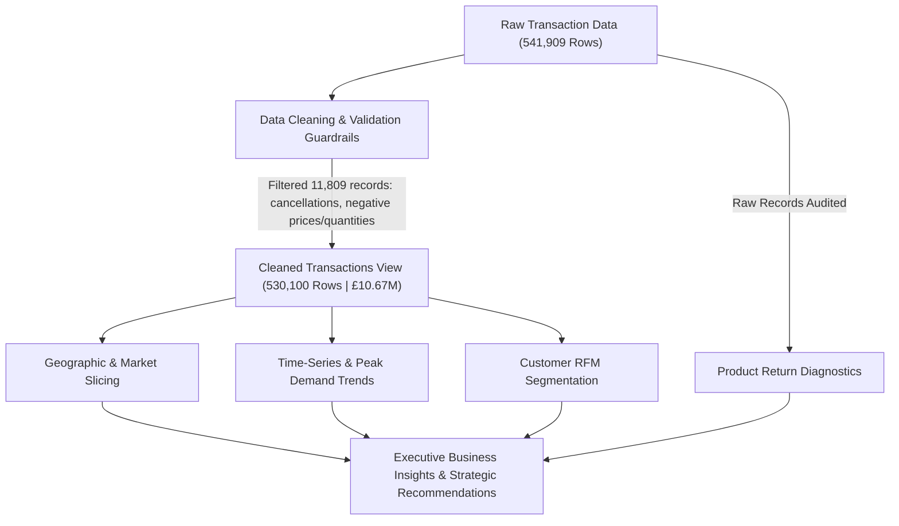
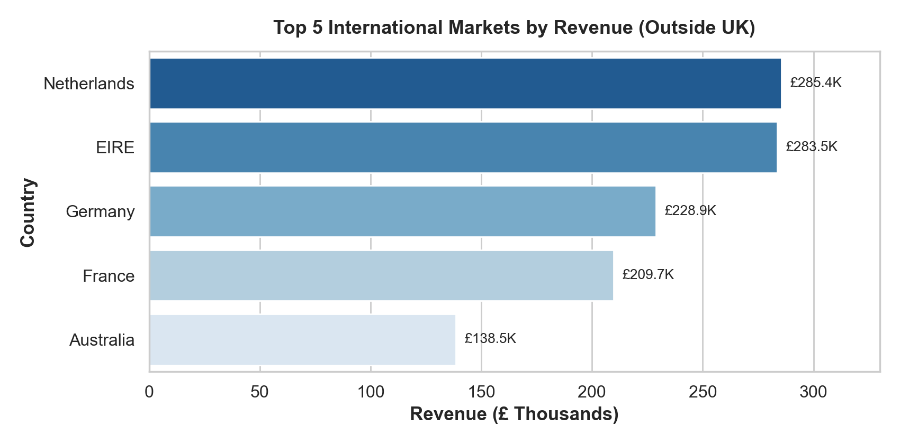
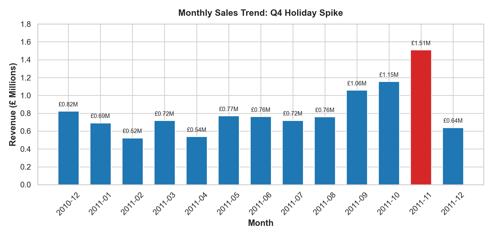
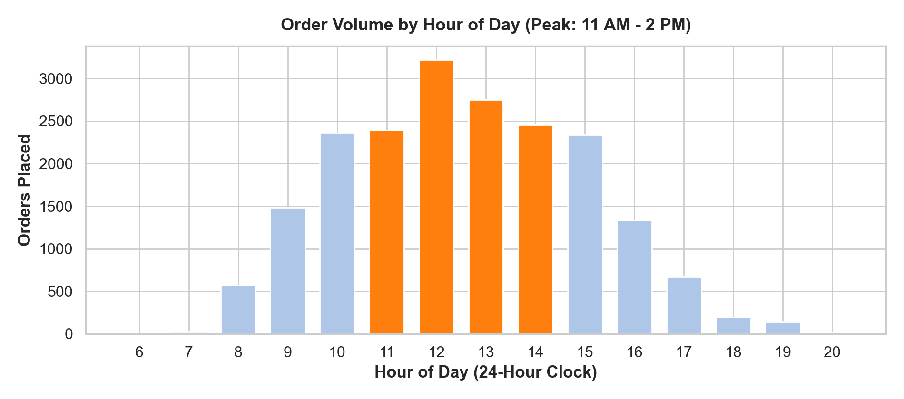
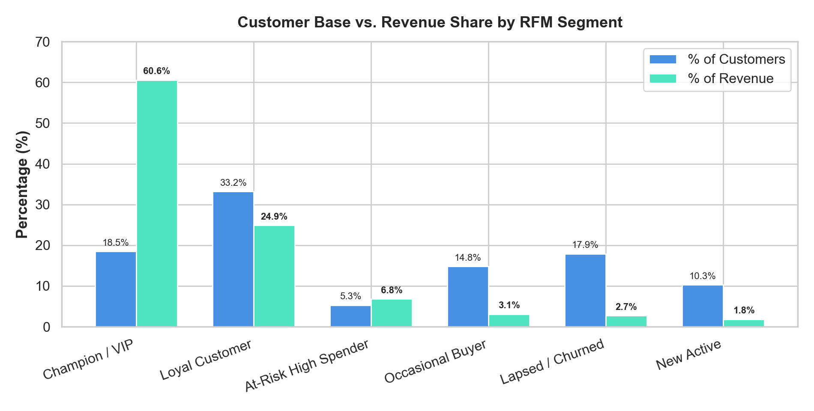

# E-Commerce Sales & Customer RFM Analytics

An end-to-end commercial data analysis on 540,000+ transaction records from an online gifts retailer, utilizing PostgreSQL and Python. This project evaluates data integrity, geographic revenue patterns, purchasing seasonality, customer retention through RFM segmentation, and product cancellation drivers.

---

## Business Questions Answered

This analysis was structured to answer five key business questions:

1. **Data Integrity:** What portion of raw transactional logs represents invalid or cancelled orders, and what is the true realized gross revenue?
2. **Geographic Distribution:** Where does revenue originate, and do international customers display different purchasing behaviors compared to the domestic UK market?
3. **Demand Timing:** What are the seasonal peaks and daily high-volume ordering windows for operational and staffing planning?
4. **Customer Retention:** How is revenue distributed across the customer base, and which customer cohorts represent the highest lifetime value or churn risk?
5. **Catalog Diagnostics:** Which products suffer from the highest return and cancellation rates, and what are the underlying operational causes?

---

## Tech Stack & Tools

* **Database & SQL:** PostgreSQL 17 (Common Table Expressions, Window Functions `DENSE_RANK()`, `LAG()`, Date Extraction, Views, Indexes)
* **Programming Language:** Python 3.13
* **Data Processing & Database Connectivity:** Pandas, SQLAlchemy, Psycopg2
* **Data Visualization:** Matplotlib, Seaborn
* **Analysis Environment:** Jupyter Notebook (`.ipynb`)
* **Analytical Frameworks:** RFM Customer Segmentation, Cohort Slicing, Opportunity Sizing

---

## Dataset Overview & Data Dictionary

The analysis is based on the **Online Retail** transaction dataset from the UCI Machine Learning Repository, containing all transactions occurring between **December 1, 2010 and December 9, 2011** for a UK-based online retail business specializing in unique all-occasion giftware.

* **Total Records:** 541,909 transactions
* **Time Period:** 01/12/2010 – 09/12/2011 (12 months)
* **Geographic Coverage:** 38 Countries
* **Data Granularity:** Line-item transaction level

### Data Dictionary

| Column Name | Data Type | Description | Business Notes |
| :--- | :--- | :--- | :--- |
| `InvoiceNo` | `VARCHAR(20)` | 6-digit unique invoice identifier | If prefixed with **'C'**, it indicates a cancelled or refunded transaction. |
| `StockCode` | `VARCHAR(20)` | Unique product (item) identifier | Distinct product codes, including service fees (e.g. `POST`, `D`, `M`). |
| `Description` | `TEXT` | Nominal product item name | Contains item description; null in 1,454 unconfirmed records. |
| `Quantity` | `INTEGER` | Quantity of items ordered per line | Negative values represent cancelled orders or damaged inventory write-offs. |
| `InvoiceDate` | `TIMESTAMP` | Date and time when the order was placed | Used to analyze monthly seasonality and peak hourly shopping windows. |
| `UnitPrice` | `NUMERIC(10,2)` | Product price per unit in Sterling (£) | Values $\le 0$ indicate system debt write-offs or promotional items. |
| `CustomerID` | `INTEGER` | 5-digit unique customer identifier | Null in ~25% of rows, representing anonymous guest checkouts without an account. |
| `Country` | `VARCHAR(100)` | Country where customer resides | Used for domestic (UK) vs. international market segmentation. |

---

## Analytical Workflow

The diagram below outlines the sequential flow of data from ingestion through analysis to strategic recommendations:



---

## Key Analysis & Insights

### 1. Data Cleaning & Integrity Guardrails
Raw e-commerce transaction logs often include cancellations, inventory adjustments, and administrative test records. Establishing validation guardrails ensured revenue metrics reflected only realized sales:

* **Filtered Records:** Removed invoices beginning with **'C'** (9,288 cancellations), transactions with quantities $\le 0$ (10,624 records), and prices $\le 0$ (2,521 records).
* **Clean Dataset:** Retained **530,100 verified transactions** (97.8% data integrity) generating **£10.67 Million** in realized revenue.

---

### 2. Geographic Revenue Breakdown
Analyzing order volume and total spend across 38 countries revealed significant differences between domestic and international purchasing habits:

* **Domestic Market (UK):** Accounts for **84.6% of revenue (£9.03M)** across 18,019 orders.
* **International Market:** Generates **15.4% of revenue (£1.64M)** across 1,941 orders.



#### Top 5 International Markets Outside the UK:
| Country | Total Orders | Total Revenue | Average Order Value (AOV) | Share of Intl Sales |
| :--- | :---: | :---: | :---: | :---: |
| **Netherlands** | 94 | **£285,446** | **£3,036.66** | 17.39% |
| **EIRE (Ireland)** | 288 | **£283,454** | £984.22 | 17.27% |
| **Germany** | 457 | **£228,867** | £500.80 | 13.94% |
| **France** | 392 | **£209,715** | £534.99 | 12.78% |
| **Australia** | 57 | **£138,521** | **£2,430.20** | 8.44% |

**Key Finding:** While Germany and France represent typical consumer retail volume (~£500 AOV), the **Netherlands (£3,036 AOV)** and **Australia (£2,430 AOV)** exhibit clear wholesale/B2B distributor behavior, purchasing large quantities per invoice.

---

### 3. Sales Seasonality & Peak Order Windows
Evaluating sales over time highlighted strong seasonal concentration and consistent intraday ordering behavior:

* **Holiday Seasonality:** Monthly revenue climbed steadily through late summer and peaked dramatically in **November 2011 at £1.51 Million (+30.7% Month-over-Month growth)**, driven by early holiday and Black Friday purchasing.
* **Daily Peak Hours:** Over **54% of daily transactions** occur between **11:00 AM and 2:00 PM**, reaching a peak at **12:00 PM (16.1% of all orders)**.




---

### 4. Customer Retention & RFM Segmentation
Registered customers (4,339 accounts, excluding guest checkouts) were evaluated across **Recency** (days since last order), **Frequency** (order count), and **Monetary Value** (total spend):

| Customer Segment | Customer Count | % of Customers | Segment Revenue | % of Total Revenue | Avg Spend / Account |
| :--- | :---: | :---: | :---: | :---: | :---: |
| **Champion / VIP** | 802 | 18.5% | **£5,400,583** | **60.6%** | £6,734 |
| **Loyal Customers** | 1,441 | 33.2% | **£2,216,382** | **24.9%** | £1,538 |
| **At-Risk High Spenders** | 232 | 5.3% | **£609,548** | **6.8%** | £2,627 |
| **Occasional Buyers** | 641 | 14.8% | **£280,505** | **3.2%** | £438 |
| **Lapsed / Churned** | 776 | 17.9% | **£243,489** | **2.7%** | £314 |
| **New Active** | 446 | 10.3% | **£160,902** | **1.8%** | £361 |



**Key Finding (Pareto Principle):** Just **18.5% of accounts (Champions)** drive **60.6% of all customer revenue**. Additionally, **232 previously high-spending customers** (£609K historical spend) have been inactive for over 90 days, presenting an immediate opportunity for re-engagement.

---

### 5. Product Returns & Cancellation Diagnostics
Auditing the uncleaned raw dataset revealed an overall storewide cancellation rate of **14.81%** across 25,900 attempted orders.

Analyzing physical products with at least 20 orders identified significant return concentrations:
* **Cinderella Chandelier (`23064`):** **29.41%** cancellation rate (fragile hanging lighting)
* **Babushka Stacking Tins (`85232B`):** **28.57%** cancellation rate (metal tins susceptible to denting)
* **Vintage Blue Kitchen Cabinet (`22656`):** **22.22%** cancellation rate (heavy furniture)
* **Rococo Wall Mirror White (`23462`):** **20.34%** cancellation rate (fragile mirror glass)
* **Savoy Art Deco Clock (`22461`):** **19.40%** cancellation rate (fragile mechanical item)

**Key Finding:** Product cancellations disproportionately impact **fragile glassware/mirrors** and **heavy furniture**, pointing to in-transit parcel damages and assembly complications.

---

## Strategic Business Recommendations

1. **Formalize a B2B Wholesale Program for Netherlands & Australia:** Introduce tier-based bulk pricing and pallet shipping terms to support high-AOV commercial buyers (~£85K potential uplift).
2. **Launch an Automated Win-Back Sequence for At-Risk High Spenders:** Deploy targeted email offers to the 232 inactive top customers to recover an estimated ~£90,000 in lapsed revenue.
3. **Stagger Warehouse Shifts to Match Midday Ordering Peaks:** Align fulfillment staffing between 11:30 AM and 3:30 PM to achieve same-day dispatch on peak orders without added headcount.
4. **Upgrade Protective Transit Packaging:** Add molded foam corners and double-wall cartons for mirrors, chandeliers, and cabinets to lower return rates closer to the catalog baseline, saving an estimated £35,000–£50,000 in damages.

> 📄 **Detailed Stakeholder Report:**  
> For the comprehensive commercial analysis and opportunity sizing methodology, view the [Business Insights Report](reports/business_insights.md).

---

## Project Structure

```text
├── README.md                                  <- Project summary & business findings
├── reports/
│   ├── business_insights.md                   <- Stakeholder-facing business report
│   └── figures/                               <- Analytical charts and figures
├── sql/
│   ├── 01_data_cleaning.sql                   <- Data cleaning audit & clean view definition
│   ├── 02_revenue_geography.sql               <- Country-level revenue aggregations
│   ├── 03_sales_trends.sql                    <- Monthly seasonality & peak order hours
│   ├── 04_customer_rfm.sql                    <- RFM metric calculation and customer tiers
│   ├── 05_cancellation_rates.sql             <- Return rate diagnostics on raw records
│   └── master_queries.sql                     <- Combined SQL analysis script
├── notebooks/
│   └── retail_analytics.ipynb                 <- Interactive Python/PostgreSQL walkthrough
├── scripts/
│   ├── load_data.py                           <- Automated PostgreSQL database loader
│   └── generate_charts.py                     <- Figure generation script
└── requirements.txt                           <- Python environment dependencies
```
