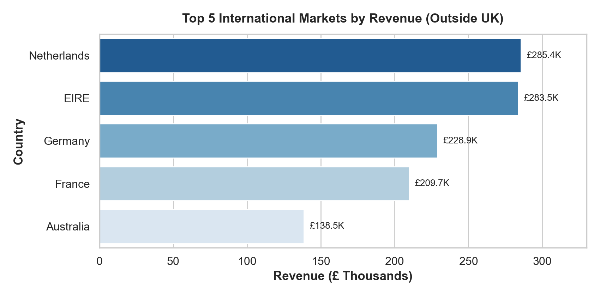
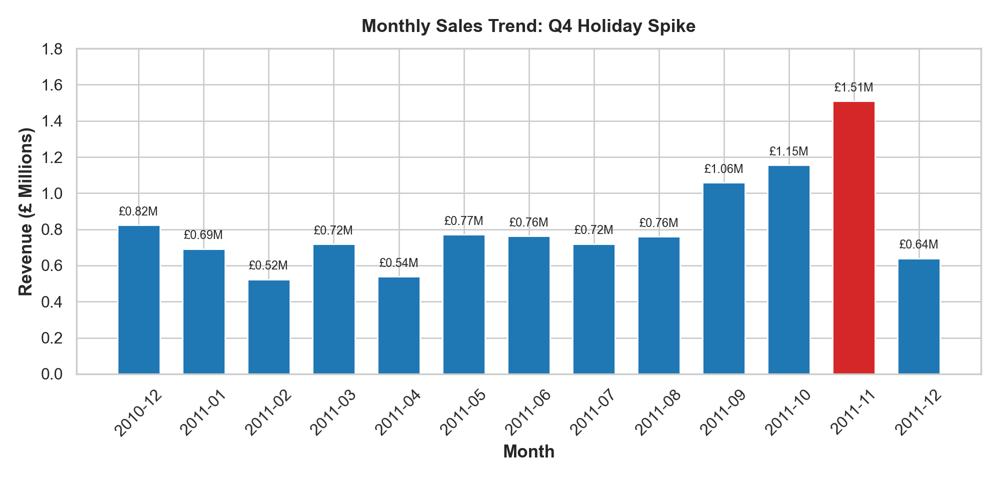
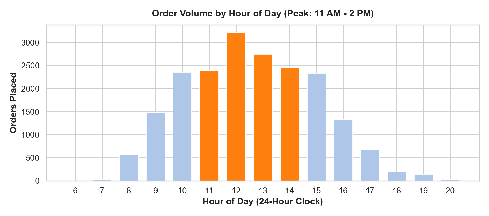
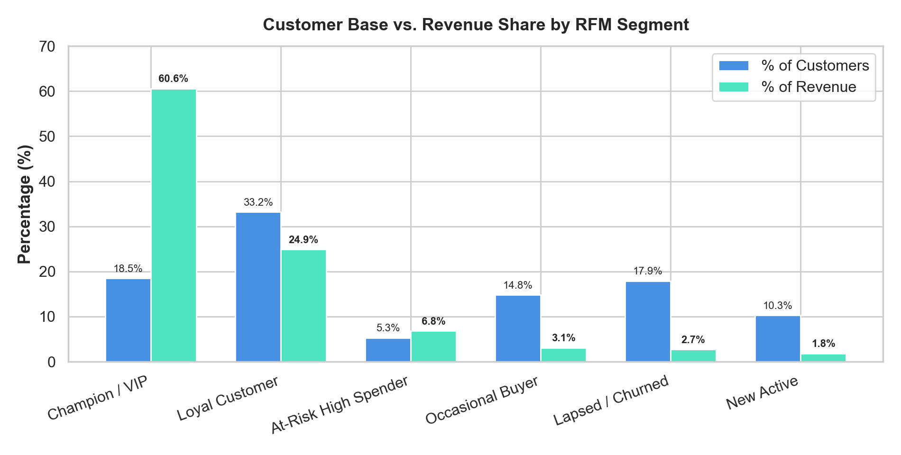

# Business Insights & Recommendations Report

**Project:** E-Commerce Sales & Customer RFM Analytics  
**Dataset:** 541,909 Transactions (UCI Online Retail)  

---

## 1. Project Goal

This project analyzes 541,909 raw e-commerce transactions from a UK-based online gift store. 

The goal was to clean the data, analyze sales patterns, group customers by their buying habits (RFM analysis), and give clear, data-backed business recommendations that any team can understand and act upon.

---

## 2. Key Numbers at a Glance

| Metric | Value | What It Means |
| :--- | :--- | :--- |
| **Total Raw Transactions** | 541,909 | The original records in the dataset |
| **Clean, Valid Transactions** | 530,100 | Real purchases after removing cancellations and errors (97.8%) |
| **Total Realized Sales** | **£10.67 Million** | Total money made from completed orders |
| **Total Orders** | 19,960 | Unique invoices |
| **Unique Tracked Customers** | 4,339 | Customers with an account (excluding guest checkouts) |
| **Average Order Value (AOV)** | £534.57 | Average amount spent per order |
| **Storewide Cancellation Rate** | 14.81% | Percentage of orders cancelled or returned |

---

## 3. Key Findings

### 1. Data Cleaning: Removing Bad Data
Before doing any analysis, we checked the raw data for errors:
* **9,288 rows** were cancelled orders (invoices starting with the letter **'C'**).
* **10,624 rows** had quantities of 0 or negative numbers (stock adjustments or returns).
* **2,521 rows** had a price of £0 or less (free items, gifts, or system errors).

**Action Taken:** We removed these 11,809 invalid rows (about 2.2% of the dataset). This left us with **530,100 clean rows** with reliable sales figures.

---

### 2. Country Sales: Domestic vs. International
* **United Kingdom:** Generates **84.6% of total revenue** (£9.03M across 18,019 orders).
* **International (Non-UK):** Generates **15.4% of revenue** (£1.64M across 1,941 orders).

#### Top 5 Countries Outside the UK:
1. **Netherlands:** £285,446 (94 orders) — **Average Order: £3,036**
2. **EIRE (Ireland):** £283,454 (288 orders) — Average Order: £984
3. **Germany:** £228,867 (457 orders) — Average Order: £501
4. **France:** £209,715 (392 orders) — Average Order: £535
5. **Australia:** £138,521 (57 orders) — **Average Order: £2,430**

> **Key Insight:** Most regular retail buyers in Germany and France spend around £500 per order. But buyers in the **Netherlands (£3,036)** and **Australia (£2,430)** spend 5 to 6 times more per order. They are likely wholesale businesses buying in bulk.

---

### 3. Sales Timing: Best Month & Peak Hours

* **Best Month (November):** Sales peak heavily in **November 2011 at £1.51 Million** (+30.7% growth compared to October). Customers buy early for the Christmas holidays and Black Friday.
* **Peak Hours (11:00 AM – 2:00 PM):** More than **54% of all daily orders** happen in the middle of the day, peaking at **12:00 PM (16.1% of daily volume)**.

---

### 4. Customer Groups (RFM Analysis)
We grouped customers using three simple measures:
* **Recency:** How many days ago was their last purchase?
* **Frequency:** How many total orders did they place?
* **Monetary:** How much total money did they spend?

| Customer Group | Number of Customers | % of Customers | Total Revenue | % of Revenue | Average Spend |
| :--- | :---: | :---: | :---: | :---: | :---: |
| **Champions / VIPs** | 802 | 18.5% | **£5,400,583** | **60.6%** | £6,734 |
| **Loyal Customers** | 1,441 | 33.2% | **£2,216,382** | **24.9%** | £1,538 |
| **At-Risk High Spenders** | 232 | 5.3% | **£609,548** | **6.8%** | £2,627 |
| **Occasional Buyers** | 641 | 14.8% | **£280,505** | **3.2%** | £438 |
| **Lapsed / Churned** | 776 | 17.9% | **£243,489** | **2.7%** | £314 |
| **New Active** | 446 | 10.3% | **£160,902** | **1.8%** | £361 |

> **Key Insight:** The top **18.5% of customers (802 people)** bring in **60.6% of the company's revenue**. Protecting this VIP group is critical.

---

### 5. Product Returns & Cancellations
Looking at the raw uncleaned records, the overall cancellation rate is **14.81%**. 

When looking at physical products with at least 20 orders, the items with the highest cancellation rates are:
* **Cinderella Chandelier:** **29.4%** cancelled (hanging glass lighting)
* **Babushka Stacking Tins:** **28.6%** cancelled (metal tins prone to denting)
* **Vintage Kitchen Cabinet:** **22.2%** cancelled (heavy furniture)
* **Rococo Wall Mirror:** **20.3%** cancelled (fragile glass)
* **Art Deco Clock:** **19.4%** cancelled (fragile mechanical clock)

> **Key Insight:** Almost all top returns are **fragile glass/decor items** or **heavy furniture**. This points to breakages and damage during shipping.

---

## 4. Practical Business Recommendations

### 1. Create a Wholesale / B2B Program for Netherlands & Australia
* **The Idea:** Offer bulk pricing, tier discounts, and pallet shipping for large buyers in these two countries.
* **How we estimated the value:**
  * Netherlands + Australia currently generate **£423,967**.
  * A simple 20% increase in bulk orders would bring in **~£85,000** in extra sales.

---

### 2. Win Back the 232 "At-Risk" Big Spenders
* **The Idea:** Send an automated email with an exclusive offer (e.g. £50 off an order over £250) to the 232 top customers who haven't ordered in over 90 days.
* **How we estimated the value:**
  * Total pool: 232 inactive customers who previously spent **£609,548** (avg. £2,627 each).
  * If a targeted email campaign wins back just **15% of them** (~35 customers):
    $$35 \text{ customers} \times £2,627 \approx \mathbf{£90,000} \text{ in recovered sales}$$

---

### 3. Match Warehouse Shifts with Peak Order Hours
* **The Idea:** Shift packing schedules so more staff are working between **11:30 AM and 3:30 PM**, when 54% of orders come in.
* **Value:** Orders can be packed and dispatched on the same afternoon, speeding up delivery times without hiring extra workers.

---

### 4. Better Protective Packaging for Fragile Items
* **The Idea:** Add bubble wrap and foam corner guards for chandeliers, mirrors, and cabinets.
* **Value:** Bringing return rates for fragile items down from ~25% to the store average of ~15% would save an estimated **£35,000 to £50,000** in lost products and return shipping.

---

## 5. Project Limitations

1. **Guest Checkouts:** About 25% of rows did not have a Customer ID. We included them in country sales and product totals, but left them out of the customer RFM analysis because guest users cannot be tracked over time.
2. **Historical Data:** The dataset is from 2010–2011, so "Recency" was calculated from the last recorded date (`December 9, 2011`), not today's date.
3. **Estimation Logic:** Recommendation values are standard business estimates (such as a 15% email win-back rate on lapsed high spenders), based on real numbers found in the data.
